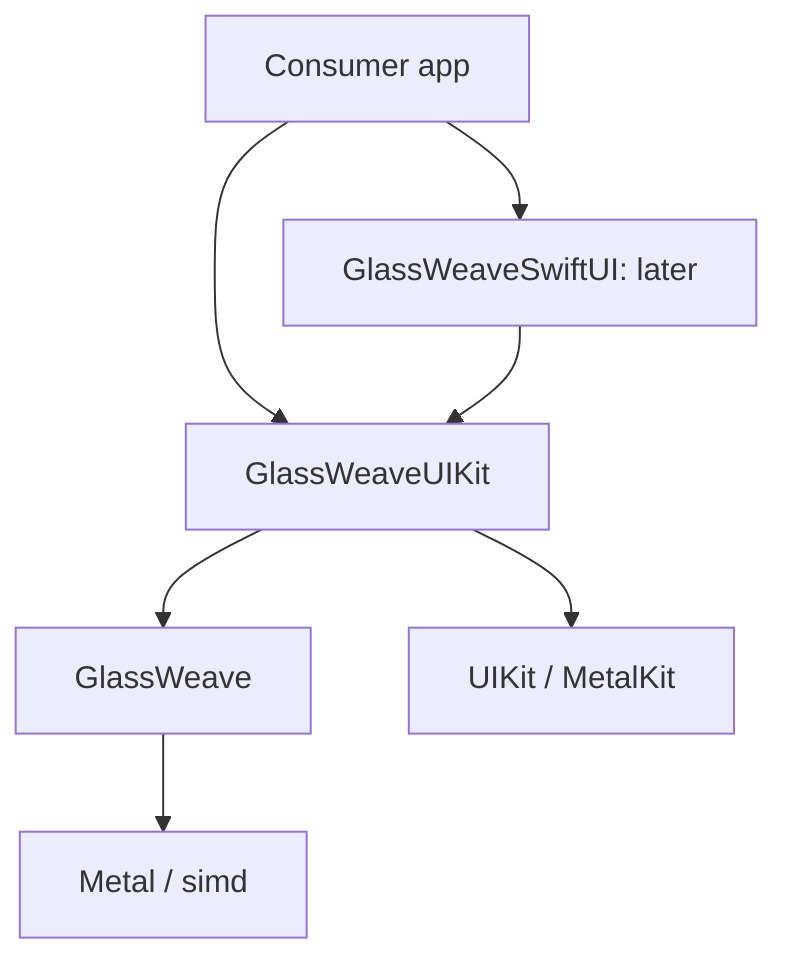
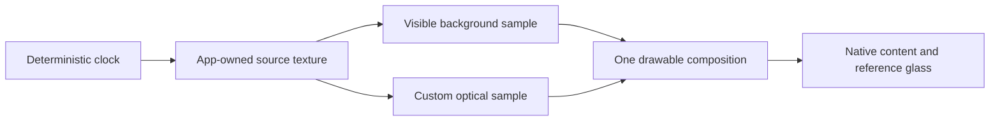

# GlassWeave architecture

This is a proposed design. The repository currently contains planning documents only. API names, targets, and file paths below are implementation guidance for Claude; none is presented as a shipped interface.

## Purpose and boundaries

GlassWeave supplies optical UI surfaces and related behavior. Apps retain native content, layout, controls, and accessibility. [Frostfield](https://github.com/Mitternacht/Frostfield) supplies general scenes and creative graphics. Neither framework's public API should require the other's scene model.

The first supported presentation environment is planned to be UIKit on iOS/iPadOS 26. A macOS 26 package floor is proposed for compiling and testing non-UI code. A macOS adapter, visionOS, television interfaces, and older deployment targets are separate decisions.

## Three explicit modes

| Mode | Material owner | Background | GlassWeave responsibility |
| --- | --- | --- | --- |
| Native | Apple | System-managed backdrop | Thin configuration and, later, choreography through public glass APIs. |
| Enhanced-native | Apple, plus separate decorative effects | System backdrop for native glass; explicit inputs for custom effects | Coordinate an independent glow or illumination effect around the native surface. |
| Custom | GlassWeave | Explicit app-owned image/texture source | Optical sampling, shape field, animation, and rendering lifetime. |

Native mode is in v0.1. Custom mode starts with one rounded panel. Enhanced-native mode is a later measured experiment.

`UIGlassEffect` provides tint and interactive behavior, and `UIGlassContainerEffect` coordinates native glass elements. The public API describes native effect configuration and composition. This design therefore does not assume a custom shader injection point or native/custom shared optical merging. That is an architectural inference from the documented interface, not a claim about Apple's internal renderer. [UIGlassEffect](https://developer.apple.com/documentation/uikit/uiglasseffect), [UIGlassContainerEffect](https://developer.apple.com/documentation/uikit/uiglasscontainereffect).

When a future custom morph joins two surfaces, GlassWeave must own both participating optical surfaces. Native controls can remain above them. A native glass control next to a custom surface remains an independent material.

## Proposed package boundaries

Introduce targets as real implementation slices require them. Do not create empty layers to fill out this diagram.

| Proposed target | Owns | Does not own |
| --- | --- | --- |
| `GlassWeave` | Surface/optical descriptors, source-frame contract, renderer, resource lifetime, deterministic effect state | UIKit/SwiftUI layout, native controls, scene graph, asset loader. |
| `GlassWeaveUIKit` | Native-glass wrapper, `MTKView` presentation, native content container, lifecycle and accessibility policies | Per-frame scene reconstruction, replacement button semantics. |
| `GlassWeaveSwiftUI` | Later SwiftUI configuration and view identity adapter over UIKit | Simulation clock, GPU resources, independent renderer. |

The native path may share configuration types with the custom path, but it must not instantiate a custom renderer or run a custom display loop. The core can import Metal without requiring a device to exist during module loading. Avoid global devices, implicit command queues, and eager pipeline compilation.

Size each host from its local bounds and `traitCollection.displayScale`, with layout owned by its containing view/window. Observe the owning `UIWindowScene` for lifecycle. Do not use `UIScreen.main`, a global scene lookup, or a process-wide paused flag to decide how a particular surface renders. Two surfaces in different windows can have different sizes, visibility, scale, and active state.

## First rendering composition

The laboratory app owns a deterministic background producer. It renders into a texture, then uses that same produced frame for both the visible background and the custom panel's refraction. The first proof presents the complete owned canvas through one `MTKView`; it does not depend on transparent Metal views discovering arbitrary views beneath them. Native text and controls live in UIKit above the canvas. A genuine native-glass reference control is composed alongside the custom panel and verified on hardware.

For the first prototype, encode source production before sampling on the same device and command queue. Use separate producer and output textures; do not sample from a render target while writing to it without an explicit, supported algorithm. Introduce crop/region optimizations only after the full-resolution reference is correct.

`MTKView` already owns drawable-related presentation behavior. A custom `CAMetalLayer` host is a later alternative only if measurement identifies a requirement. Acquire the drawable late, handle an unavailable drawable by skipping the frame, and present only after encoding its rendering work. [MTKView](https://developer.apple.com/documentation/metalkit/mtkview), [currentDrawable](https://developer.apple.com/documentation/metalkit/mtkview/currentdrawable).

## Source-frame contract

Define this contract before accepting outside producers. It is a behavioral contract; do not freeze the concrete Swift API before the first proof works.

| Field or responsibility | Required meaning |
| --- | --- |
| Device identity | Texture and consuming renderer use the same `MTLDevice`; reject a mismatch. |
| Frame identity | Monotonic producer sequence plus capture/presentation time, so stale data can be observed and correlated. |
| Extent | Pixel dimensions and the valid content rectangle; distinguish these from view dimensions in points. |
| Coordinate mapping | An explicit transform from destination coordinates to normalized source UVs, including scale, crop, orientation, and vertical origin. |
| Texture usage | Source supports shader reading; its format and sample count satisfy the accepted source contract. |
| Color and alpha | Explicit SDR color-space and alpha conventions; no silently inferred HDR or alpha interpretation. |
| Readiness | GPU ordering that makes producer writes visible before consumer sampling. A Swift actor hop is not a GPU dependency. |
| Lifetime | A lease retains the texture and related allocations until every submitted consumer finishes. |
| Completion | Producer receives completion only when it is safe to reuse the storage, including cancellation and skipped-frame paths. |

For v0.1, use one documented SDR convention: sRGB BGRA8 textures with shader sampling in linear light and an explicitly documented alpha convention. Prefer an opaque source in the first laboratory to isolate optical correctness. A later transparent source path must consistently use premultiplied alpha. Reject unsupported formats rather than displaying a plausible but incorrect result. Wide color, HDR, YCbCr video import, and color conversion are later capabilities.

Treat frame metadata as immutable for a submission. Keep mutable GPU objects under an explicit owner; do not apply `@unchecked Sendable` to silence concurrency errors. The UI host runs on the main actor. The rendering owner manages encoding and resource state. Pure descriptors may be `Sendable` when their stored values actually satisfy that contract.

### Synchronization progression

1. v0.1: app-owned producer and consumer on one queue with explicit encoding order and resource retention through completion.
2. Optional interoperability: another producer on the same device and agreed queue, with a documented lease/completion bridge.
3. Later cross-queue import: an explicit shared-event or other supported synchronization protocol; never infer readiness from submission time or a CPU lock.

If a producer supplies no fresh frame, the policy is explicit: retain the last valid leased frame only while it remains legally owned, or show the configured opaque/native fallback. Never sample released storage or block the UI while waiting indefinitely for a new source.

## Why the backdrop is explicit

Placing a Metal view over arbitrary application UI does not provide a general texture of the application backdrop. SwiftUI's `layerEffect` receives the rasterized contents of the modified view, and UIKit/AppKit-backed content can be unavailable in that filtered layer. This is not a foundation for arbitrary live application capture. [layerEffect](https://developer.apple.com/documentation/swiftui/view/layereffect(_:maxsampleoffset:isenabled:)).

Use native mode for system-managed backdrop behavior. Use custom mode for owned backgrounds. A future snapshot mode would need an explicit freshness, privacy, performance, and unsupported-content contract; continuous screen capture is outside this plan.

## Optical model and API limits

The first model needs only a rounded-rectangle shape field, bounded refraction displacement, restrained edge illumination, tint, and an opacity/legibility policy. Units must be explicit: positions and radii in points at the UI boundary, pixels only after conversion; normalized optical coefficients with documented valid ranges. Validate non-finite and out-of-range inputs at the public boundary.

Expose only parameters that have a demonstrated use. Avoid a full material graph, universal shader DSL, or a large collection of named visual presets in v0.1. Thickness approximation, dispersion, ripples, and richer light response can become independent later features with their own accuracy and cost descriptions.

Errors should identify an actionable condition such as unsupported source format, incompatible device, pipeline creation failure, or unavailable capability. A missing drawable or zero-size view is a transient skip, not a fatal library error. A requested custom mode must never silently masquerade as a successful custom render when it actually fell back; expose the effective mode/reason in diagnostics.

## Scheduling and resources

- Render static surfaces on demand; use continuous drawing only while a source or effect is changing.
- Pause hidden/backgrounded presentation and coalesce obsolete updates.
- Bound in-flight work and recycle textures only after GPU completion.
- Prepare common pipelines before interaction; no pipeline compilation in the steady-state draw path.
- Update uniform values for animation rather than replacing the renderer or texture pool.
- Rebuild size-dependent resources only on a real size/scale/format change.
- Keep UI submission distinct from frame simulation; SwiftUI state updates must not drive individual particles or shader frames.
- Keep lifecycle state per host/owning scene; one hidden window must not pause a visible surface in another window.

`MTKView` supports event-driven drawing when `isPaused` and `enableSetNeedsDisplay` are configured together. These controls underpin the proposed idle policy. [enableSetNeedsDisplay](https://developer.apple.com/documentation/metalkit/mtkview/enablesetneedsdisplay).

## Backend decision

Use conventional Metal command submission to establish the first proof. Evaluate Metal 4 with the same scene, shader behavior, and measurement recipe after that proof. Runtime capability checks must accompany OS availability checks. A Metal 4-only implementation, a conventional implementation, or two supported paths are all possible outcomes of the experiment; no result is presumed. [Understanding the Metal 4 core API](https://developer.apple.com/documentation/metal/understanding-the-metal-4-core-api), [Metal feature tables](https://developer.apple.com/metal/availability/).

## Native behavior and accessibility

The visual surface is decorative; native content owns accessibility elements and input actions. Define who handles a gesture before adding touch-driven optical effects. Observing a touch must not steal button activation or scrolling. Preserve Dynamic Type, focus order, light/dark appearance, and readable native content. Reduce Motion should suppress nonessential movement. Reduce Transparency should select a legible opaque presentation without changing the control's semantics.

The application remains responsible for content semantics and layout. GlassWeave must provide predictable hooks and documented defaults; the first example must demonstrate those defaults with actual controls rather than flattened text images.

## Sharing with Frostfield

Start with no package dependency. A later example may depend on both packages and exchange an explicit texture lease. A future `FrostfieldMetal` product is worth considering only after both implementations need the same measured resource/pipeline behavior. That product must not import scene nodes, mesh loaders, materials, or UI adapters. Avoid exposing its internal types through GlassWeave's public API unless that dependency is a deliberate long-term contract.

See [the plan](../tasks/plan.md), [task checklist](../tasks/todo.md), and [validation protocol](validation.md) for implementation order and acceptance evidence.

## Language decision

Use Swift for CPU implementation and native APIs, MSL for custom GPU work, and a
small verified C-compatible data-layout boundary when needed. The proposed
manifest baseline is Swift tools 6.2 with Swift 6 language mode. See the
[language strategy](language-strategy.md)
for toolchain distinctions, layout tests, ownership rules, foreign-language
admission gates, and conditional backend alternatives.
