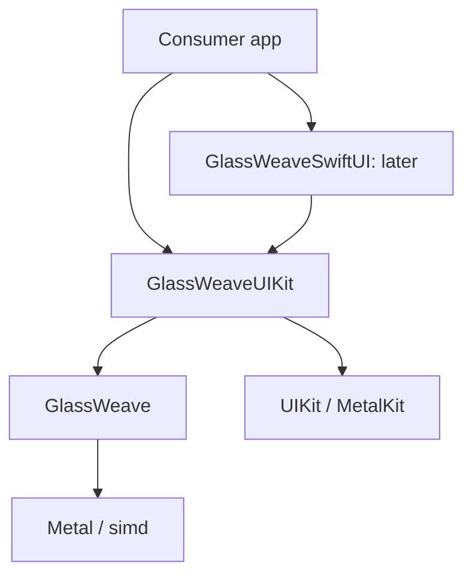
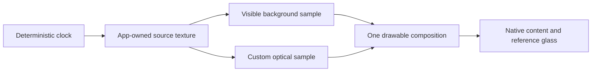

# GlassWeave architecture

This is a proposed design. API names, targets, and file paths below are implementation guidance for Claude; none is presented as a shipped interface. Sections marked as implemented describe code that exists in the repository; [the task checklist](../tasks/todo.md) records what has been verified.

## Purpose and boundaries

GlassWeave supplies optical UI surfaces and related behavior. Apps retain native content, layout, controls, and accessibility. [Frostfield](https://github.com/Mitternacht/Frostfield) supplies general scenes and creative graphics. Neither framework's public API should require the other's scene model.

The first supported presentation environment is planned to be UIKit on iOS/iPadOS 26. A macOS 26 package floor is proposed for compiling and testing non-UI code. A macOS adapter, visionOS, television interfaces, and older deployment targets are separate decisions.

## Three explicit modes

| Mode | Material owner | Background | GlassWeave responsibility |
| --- | --- | --- | --- |
| Native | Apple | System-managed backdrop | Thin configuration and, later, choreography through public glass APIs. |
| Enhanced-native | Apple, plus separate decorative effects | System backdrop for native glass; explicit inputs for custom effects | Coordinate an independent glow or illumination effect around the native surface. |
| Custom | GlassWeave | Explicit app-owned image/texture source | Optical sampling, shape field, animation, and rendering lifetime. |

Native mode is in v0.1. Custom mode starts with one rounded panel. Enhanced-native mode is a later measured experiment.

Implemented (GW-03): `NativeGlassView` in `GlassWeaveUIKit` is native mode. It is a `UIVisualEffectView` whose effect is a public `UIGlassEffect` built from a configuration of tint and `isInteractive`; native controls go in its `contentView`. It references no GlassWeave rendering type, and a test confirms that creating, configuring, laying out, and actuating it records no renderer in the renderer census and places no `MTKView` in its hierarchy.

`UIGlassEffect` provides tint and interactive behavior, and `UIGlassContainerEffect` coordinates native glass elements. The public API describes native effect configuration and composition. This design therefore does not assume a custom shader injection point or native/custom shared optical merging. That is an architectural inference from the documented interface, not a claim about Apple's internal renderer. [UIGlassEffect](https://developer.apple.com/documentation/uikit/uiglasseffect), [UIGlassContainerEffect](https://developer.apple.com/documentation/uikit/uiglasscontainereffect).

When a future custom morph joins two surfaces, GlassWeave must own both participating optical surfaces. Native controls can remain above them. A native glass control next to a custom surface remains an independent material.

## Proposed package boundaries

Introduce targets as real implementation slices require them. Do not create empty layers to fill out this diagram.

| Proposed target | Owns | Does not own |
| --- | --- | --- |
| `GlassWeave` | Surface/optical descriptors, source-frame contract, renderer, resource lifetime, deterministic effect state | UIKit/SwiftUI layout, native controls, scene graph, asset loader. |
| `GlassWeaveUIKit` | Native-glass wrapper, `MTKView` presentation, native content container, lifecycle and accessibility policies | Per-frame scene reconstruction, replacement button semantics. |
| `GlassWeaveSwiftUI` | Later SwiftUI configuration and view identity adapter over UIKit | Simulation clock, GPU resources, independent renderer. |

The native path may share configuration types with the custom path, but it must not instantiate a custom renderer or run a custom display loop. The core can import Metal without requiring a device to exist during module loading. Avoid global devices, implicit command queues, and eager pipeline compilation.

Size each host from its local bounds and `traitCollection.displayScale`, with layout owned by its containing view/window. Observe the owning `UIWindowScene` for lifecycle. Do not use `UIScreen.main`, a global scene lookup, or a process-wide paused flag to decide how a particular surface renders. Two surfaces in different windows can have different sizes, visibility, scale, and active state.

## First rendering composition

The laboratory app owns a deterministic background producer. It renders into a texture, then uses that same produced frame for both the visible background and the custom panel's refraction. The first proof presents the complete owned canvas through one `MTKView`; it does not depend on transparent Metal views discovering arbitrary views beneath them. Native text and controls live in UIKit above the canvas. A genuine native-glass reference control is composed alongside the custom panel and verified on hardware.

For the first prototype, encode source production before sampling on the same device and command queue. Use separate producer and output textures; do not sample from a render target while writing to it without an explicit, supported algorithm. Introduce crop/region optimizations only after the full-resolution reference is correct.

Implemented (GW-06): `GlassRenderer.drawProducing` makes one command buffer per draw, lets the app's producer encode the new frame into its own texture in that command buffer (readiness `.encoded(in:)`), then encodes the background and the panel later in the same command buffer and commits it once. `GlassSurfaceView.setFrameProducer` runs that path for every draw (an app request through `requestFrame()`, a resize, a scale or panel change), so the visible background and the refraction always show the frame produced for that draw, including after a resize while paused. The laboratory's producer (`ProceduralBackground`) renders a pure function of a deterministic clock (one 1/60 s step per `UIUpdateLink` tick of the stage's own window) into a pool of at most three textures; a texture returns to the pool only when its lease is released, and a tick with no free texture skips production rather than allocating. The surface draws through `MTKView`'s own `draw` cycle; the app never touches the drawable.

| Path | Ordering and lifetime |
| --- | --- |
| Produced and drawn | Writes and sampling share one command buffer, in encode order. The submission hold ends when it completes. |
| Produced, no drawable | The command buffer is still committed so the writes run; the frame stays current and the skipped use ends only when the writes complete, so the producer never hears "reusable" while they are in flight. |
| Produced frame rejected | The command buffer is committed, the producer hold is retired when it completes, the error is thrown (`GlassSurfaceView.lastProducedFrameError`), and the previous source stays. |
| Producer returns nothing | The current source is redrawn in a fresh command buffer. |
| `.encoded(in:)` handed to `setSource` directly | Accepted only once that command buffer is enqueued or committed (its queue position is then fixed); otherwise `.commandBufferNotEnqueued`. |

`MTKView` already owns drawable-related presentation behavior. A custom `CAMetalLayer` host is a later alternative only if measurement identifies a requirement. Acquire the drawable late, handle an unavailable drawable by skipping the frame, and present only after encoding its rendering work. [MTKView](https://developer.apple.com/documentation/metalkit/mtkview), [currentDrawable](https://developer.apple.com/documentation/metalkit/mtkview/currentdrawable).

## Source-frame contract

Define this contract before accepting outside producers. It is a behavioral contract; do not freeze the concrete Swift API before the first proof works.

| Field or responsibility | Required meaning |
| --- | --- |
| Device identity | Texture and consuming renderer use the same `MTLDevice`; reject a mismatch. |
| Frame identity | Monotonic producer sequence plus capture/presentation time, so stale data can be observed and correlated. |
| Extent | Pixel dimensions and the valid content rectangle; distinguish these from view dimensions in points. |
| Coordinate mapping | An explicit transform from destination coordinates to normalized source UVs, including scale, crop, orientation, and vertical origin. |
| Texture usage | Source supports shader reading; its format and sample count satisfy the accepted source contract. |
| Color and alpha | Explicit SDR color-space and alpha conventions; no silently inferred HDR or alpha interpretation. |
| Readiness | GPU ordering that makes producer writes visible before consumer sampling. A Swift actor hop is not a GPU dependency. |
| Lifetime | A lease retains the texture and related allocations until every submitted consumer finishes. |
| Completion | Producer receives completion only when it is safe to reuse the storage, including cancellation and skipped-frame paths. |

For v0.1, use one documented SDR convention: sRGB BGRA8 textures with shader sampling in linear light and an explicitly documented alpha convention. Prefer an opaque source in the first laboratory to isolate optical correctness. A later transparent source path must consistently use premultiplied alpha. Reject unsupported formats rather than displaying a plausible but incorrect result. Wide color, HDR, YCbCr video import, and color conversion are later capabilities.

Treat frame metadata as immutable for a submission. Keep mutable GPU objects under an explicit owner; do not apply `@unchecked Sendable` to silence concurrency errors. The UI host runs on the main actor. The rendering owner manages encoding and resource state. Pure descriptors may be `Sendable` when their stored values actually satisfy that contract.

### Implemented v0.1 contract (GW-04)

GW-04 settled the rows above in code. This is the first concrete form, used
by the laboratory and tests; it is not yet a frozen public API.

| Row | Implementation |
| --- | --- |
| Device identity | `BackgroundRenderer.setSource` rejects a texture whose `device` is not the renderer's (`.deviceMismatch`). |
| Frame identity | `BackgroundFrame.frameID` (must increase per renderer) and `timestamp` (`Duration` on the producer's clock, must not go back). Stale frames throw `.outOfOrderFrame` / `.timestampRegressed`. |
| Extent | The texture's pixel size plus `validRect` in texture pixels (origin at the top-left of texture memory). View size in points never enters the source contract; `GlassSurfaceView` converts bounds × `displayScale` to target pixels. |
| Coordinate mapping | Destination UV → upright UV (aspect fill, centered crop) → stored UV (undo `SourceOrientation.rotation`, a clockwise quarter-turn count, then `verticalOrigin`) → texture UV (place `validRect`). Samples are clamped half a texel inside `validRect`. Display scale changes pixel count, not the mapping. |
| Texture usage | Single-sample `.type2D` with `.shaderRead`; anything else is rejected. |
| Color and alpha | `.sRGBOpaque` only: `bgra8Unorm_srgb`, decoded to linear light on read, alpha ignored. The output is `bgra8Unorm` holding sRGB-encoded values written by the shader, because the iOS Simulator cannot render to sRGB targets. |
| Readiness | `.committed(on: queue)`: the producer committed its writes to the renderer's own queue before handing over the frame. Another queue is rejected (`.queueMismatch`). GW-06 adds `.encoded(in: commandBuffer)` for writes encoded earlier in the draw's own command buffer (see the first rendering composition above). |
| Lifetime | `BackgroundFrameLease` keeps the frame. The renderer holds a presentation hold while the frame is current and one submission hold per draw, ended in the command buffer's completed handler. Command buffers retain the texture until they complete. |
| Completion | The lease's `onRelease` runs exactly once, after the producer called `retire()` and every hold ended. It reports completed, failed, skipped (for example, no drawable), and cancelled uses. |

Defined skips (`BackgroundRenderOutcome.skipped`): no source, zero-size
target, no drawable, released source, or no encoder. Missing-source and
zero-size checks run before a drawable is requested. No path waits for GPU
completion. Known limit, still open: `GlassSurfaceView` acquires its drawable
on the main thread through `MTKView.currentRenderPassDescriptor`
(`CAMetalLayer.nextDrawable()`), which blocks until a drawable is free or the
layer's one-second timeout passes, so the host's no-drawable skip comes only
after a main-thread wait. GW-07's two-frame in-flight bound normally keeps
that wait to about one display refresh; it does not remove it (GW-04's third
acceptance item stays open).

### Synchronization progression

1. v0.1: app-owned producer and consumer on one queue with explicit encoding order and resource retention through completion.
2. Optional interoperability: another producer on the same device and agreed queue, with a documented lease/completion bridge.
3. Later cross-queue import: an explicit shared-event or other supported synchronization protocol; never infer readiness from submission time or a CPU lock.

If a producer supplies no fresh frame, the policy is explicit: retain the last valid leased frame only while it remains legally owned, or show the configured opaque/native fallback. Never sample released storage or block the UI while waiting indefinitely for a new source.

## Why the backdrop is explicit

Placing a Metal view over arbitrary application UI does not provide a general texture of the application backdrop. SwiftUI's `layerEffect` receives the rasterized contents of the modified view, and UIKit/AppKit-backed content can be unavailable in that filtered layer. This is not a foundation for arbitrary live application capture. [layerEffect](https://developer.apple.com/documentation/swiftui/view/layereffect(_:maxsampleoffset:isenabled:)).

Use native mode for system-managed backdrop behavior. Use custom mode for owned backgrounds. A future snapshot mode would need an explicit freshness, privacy, performance, and unsupported-content contract; continuous screen capture is outside this plan.

## Optical model and API limits

The first model needs only a rounded-rectangle shape field, bounded refraction displacement, restrained edge illumination, tint, and an opacity/legibility policy. Units must be explicit: positions and radii in points at the UI boundary, pixels only after conversion; normalized optical coefficients with documented valid ranges. Validate non-finite and out-of-range inputs at the public boundary.

Expose only parameters that have a demonstrated use. Avoid a full material graph, universal shader DSL, or a large collection of named visual presets in v0.1. Thickness approximation, dispersion, ripples, and richer light response can become independent later features with their own accuracy and cost descriptions.

Errors should identify an actionable condition such as unsupported source format, incompatible device, pipeline creation failure, or unavailable capability. A missing drawable or zero-size view is a transient skip, not a fatal library error. A requested custom mode must never silently masquerade as a successful custom render when it actually fell back; expose the effective mode/reason in diagnostics.

### Implemented optical model (GW-05)

`GlassRenderer` draws the background pass and then one rounded panel in the
same render pass. The panel's quad covers the panel rectangle grown by one
pixel; its fragment shader (`Shaders/Glass.metal`) samples the same frame
through the same destination-to-source mapping and valid-rectangle clamp as
the background, so the refraction cannot show a different frame or read
outside the valid rectangle. `GlassPanelGeometry` mirrors the shader math on
the CPU; the GPU tests compare the two pixel by pixel.

| Element | Definition |
| --- | --- |
| Units | `GlassPanel.frame`, `cornerRadius`, and `bezelWidth` are points in the host surface's coordinate space (origin top-left, y down). The renderer multiplies by the host's display scale at draw time; nothing in points reaches the GPU. `refraction`, `edgeHighlight`, and the tint are normalized to 0...1. |
| Shape field | Rounded-rectangle signed distance in pixels. Rim normals come from the same rectangle with corner radius `max(cornerRadius, bezelWidth)`, so the refraction direction turns smoothly around a corner tighter than the rim. |
| Refraction | Inside the rim (depth `d` below the outline, `d < bezelWidth`) the sample moves toward the interior by `refraction × bezelWidth / 2 × (1 − d / bezelWidth)²` pixels. The bound is `refraction × bezelWidth / 2`, and the depth mapping never folds over for refraction in 0...1. The interior is flat and samples in place. |
| Tint | Mixed in linear light: `mix(refracted, tint, strength)`. Components are sRGB-encoded at the API and decoded on the CPU. |
| Edge illumination | `edgeHighlight × 0.25 × rim³ × (0.4 + 0.6 × facing)` of the way to white, with `rim` 1 at the outline and 0 at the rim's inner edge and `facing` the normal's alignment with light from the upper left. At most a quarter of the way to white. |
| Edge and alpha | One-pixel antialiased coverage mixes the glass with the undisplaced background in linear light. Every pixel is written opaque (alpha 1); the source alpha is ignored as in GW-04. |
| Normalization | Non-finite values are rejected with `GlassParameterError.nonFinite(field)` and leave the current panel in place. Finite values are clamped: negative lengths to 0, lengths to half the panel's shorter side, coefficients and tint to 0...1, negative frame sizes to 0. An empty panel draws nothing. `GlassRenderer.panel` reports the values drawn. |
| Tolerance | Output is `bgra8Unorm` holding sRGB-encoded values. Zero refraction reproduces the source, and smooth or uniform fixtures match the CPU model, within one 8-bit step per channel (Metal fast math). Hard high-contrast edges are checked by properties (range, gray stays gray, unchanged where nothing is displaced) because GPU filter weights are quantized. |

The parameters are a first lab-tuned set, not a frozen public API; which of
them stay public is decided after the coexistence proof (plan decision 3).

## Scheduling and resources

- Render static surfaces on demand; use continuous drawing only while a source or effect is changing.
- Pause hidden/backgrounded presentation and coalesce obsolete updates.
- Bound in-flight work and recycle textures only after GPU completion.
- Prepare common pipelines before interaction; no pipeline compilation in the steady-state draw path.
- Update uniform values for animation rather than replacing the renderer or texture pool.
- Rebuild size-dependent resources only on a real size/scale/format change.
- Keep UI submission distinct from frame simulation; SwiftUI state updates must not drive individual particles or shader frames.
- Keep lifecycle state per host/owning scene; one hidden window must not pause a visible surface in another window.

`MTKView` supports event-driven drawing when `isPaused` and `enableSetNeedsDisplay` are configured together. These controls underpin the proposed idle policy. [enableSetNeedsDisplay](https://developer.apple.com/documentation/metalkit/mtkview/enablesetneedsdisplay).

### Implemented lifecycle (GW-07)

`FrameScheduler` (core, package access) owns one host's policy; its state
machine `FrameLedger` is a value type the tests drive directly, and the
thread-safe wrapper is what Metal completion handlers capture.
`GlassSurfaceView` runs every draw through it. `FrameTexturePool` (core,
public) bounds a producer's textures; the laboratory's moving source uses it.

| Rule | Implementation |
| --- | --- |
| On demand | The `MTKView` is paused with `enableSetNeedsDisplay`. A draw happens only after a request (new source, panel, pixel size, display scale, producer, or `requestFrame()`). Requests before the next display pass merge into one (`FrameStatistics.coalesced`). A display pass with nothing requested (one UIKit starts itself, or a second wake-up for a request an earlier pass drew) draws nothing and calls no producer, so a stationary source with a settled surface submits nothing. |
| Visibility per host | A surface draws only while it is in a window, neither it nor an ancestor is hidden or at alpha ≈ 0, and its *own* window scene is `foregroundActive` or `foregroundInactive` (an inactive scene beside an active one is still on screen). It observes only that scene's `UIScene` messages (typed `NotificationCenter` messages, re-subscribed in `didMoveToWindow`), so another scene's state never affects it. Requests while not visible leave one pending frame, drawn once when visible again. An ancestor's `isHidden` is not observable; it is checked on every request, layout pass, and draw. |
| In-flight bound | At most `GlassSurfaceView.maximumFramesInFlight` (2) frames are committed and not completed. A display pass at the bound is deferred (`deferredAtLimit`) and its frame stays pending; the next completion schedules it. A request or completion that arrives during a draw (from the producer or `renderObserver`) leaves its wake-up to the end of the draw: a committed draw's completion schedules the pending frame, and a skipped draw, which has no completion, schedules it itself before `renderObserver` runs. Display passes asked for from inside a draw are requested after the draw returns. Nothing queues and nothing waits. Two leaves one of the layer's three drawables free while one is on screen; a completed frame not yet presented can still make the next drawable wait for a display refresh, never for GPU work. |
| Texture bound | `FrameTexturePool` holds at most `capacity` textures, counting those in use, and takes a texture back only when GlassWeave releases its frame (after the last GPU use). With every texture in use, `checkout` returns `nil` and the producer skips that frame. A new size discards free textures of the old size at once and in-use ones when released; `trim()` discards free textures and marks in-use ones. |
| Hidden resources | Leaving the visible state stops drawing and calls the app's `visibilityHandler`; GlassWeave itself frees nothing. The `CAMetalLayer` keeps its drawable pool (up to three drawables at the drawable size, about 7 MiB each at the laboratory's 1206 × 1524 px iPhone stage), because `MTKView.releaseDrawables()` releases only depth/stencil and multisample textures, which the surface does not create (an earlier version called it to no effect). The laboratory trims its source pool in the handler and stops its clock, so a hidden stage keeps only the presented frame's source texture plus the layer's drawables. Dropping the layer's drawables while hidden is not implemented or measured. |
| Teardown | Command buffers retain every texture they use; leases keep frames until their last submission completes; the pool's ledger outlives the pool for late returns. Dropping the renderer, scheduler, and pool while a frame is in flight releases nothing until the GPU finishes. No path calls `waitUntilCompleted`; CI rejects it in package and laboratory sources. |

The renderers hand each command buffer to the host just before committing it
(package-level `onCommit`), on every committing path including a rejected
produced frame and a produced frame without a drawable, so the host counts
exactly the GPU work in flight.

### Implemented measurement (GW-09)

`RenderMetrics` (core, public) is opt-in: with `GlassRenderer.metrics` unset
the draw path reads no clock. When set, the renderer times each draw call on
the calling thread, splitting the app's producer and the host's target
acquisition from GlassWeave's own preparation and encoding, and adds one
completed handler per committed command buffer that records
`gpuStartTime`/`gpuEndTime` and the status. Samples go into a fixed-capacity
ring (default 18,000, five minutes at 60 Hz) behind a `Mutex`, so a long run
uses bounded memory and completion threads never block the drawing thread
for more than one append. `reset()` starts a new window and ignores command
buffers committed before it. The renderer, not the UIKit host, measures, so
the same numbers come from `GlassSurfaceView`, an offscreen host, or a
consumer's own host. `docs/validation.md` lists what it does not measure.

## Backend decision

Use conventional Metal command submission to establish the first proof. Evaluate Metal 4 with the same scene, shader behavior, and measurement recipe after that proof. Runtime capability checks must accompany OS availability checks. A Metal 4-only implementation, a conventional implementation, or two supported paths are all possible outcomes of the experiment; no result is presumed. [Understanding the Metal 4 core API](https://developer.apple.com/documentation/metal/understanding-the-metal-4-core-api), [Metal feature tables](https://developer.apple.com/metal/availability/).

## Native behavior and accessibility

The visual surface is decorative; native content owns accessibility elements and input actions. Define who handles a gesture before adding touch-driven optical effects. Observing a touch must not steal button activation or scrolling. Preserve Dynamic Type, focus order, light/dark appearance, and readable native content. Reduce Motion should suppress nonessential movement. Reduce Transparency should select a legible opaque presentation without changing the control's semantics.

The application remains responsible for content semantics and layout. GlassWeave must provide predictable hooks and documented defaults; the first example must demonstrate those defaults with actual controls rather than flattened text images.

Implemented (GW-08): `GlassSurfaceView` hides its own accessibility elements
(`accessibilityElementsHidden`), so neither it nor its `MTKView` appears to
assistive technologies. `GlassAccessibilityPolicy` (GlassWeaveUIKit) defines
what is drawn: under Reduce Transparency the panel keeps its frame and corner
radius and becomes opaque `secondarySystemBackground` resolved for the
surface's traits, with no refraction or edge illumination; Reduce Motion
changes nothing in the panel, which has no motion, and is reported through
`accessibilitySettingsHandler` so the app stops its source. The surface reads
`GlassAccessibilitySettings` from `UIAccessibility` (updated on its change
notifications) or from fixed values (`accessibilitySettingsSource`), and keeps
the app's panel (`panel`) apart from the panel drawn (`presentedPanel`). For
see-through glass, the core legibility rule (`GlassTint.worstCaseContrast`,
`minimumStrength(forContrast:againstTextLuminance:)`) gives the lowest
contrast between text and the flat interior over any background from black to
white, since the interior mixes background and tint in linear light; the
laboratory raises its tint strength to keep 4.5:1 (7:1 with Increase
Contrast) for its label text. The results are recorded in the
[accessibility matrix](validation.md#recorded-accessibility-matrix-gw-08-2026-11-08).

## Sharing with Frostfield

Start with no package dependency. A later example may depend on both packages and exchange an explicit texture lease. A future `FrostfieldMetal` product is worth considering only after both implementations need the same measured resource/pipeline behavior. That product must not import scene nodes, mesh loaders, materials, or UI adapters. Avoid exposing its internal types through GlassWeave's public API unless that dependency is a deliberate long-term contract.

See [the plan](../tasks/plan.md), [task checklist](../tasks/todo.md), and [validation protocol](validation.md) for implementation order and acceptance evidence.

## Language decision

Use Swift for CPU implementation and native APIs, MSL for custom GPU work, and a
small verified C-compatible data-layout boundary when needed. The proposed
manifest baseline is Swift tools 6.2 with Swift 6 language mode. See the
[language strategy](language-strategy.md)
for toolchain distinctions, layout tests, ownership rules, foreign-language
admission gates, and conditional backend alternatives.
