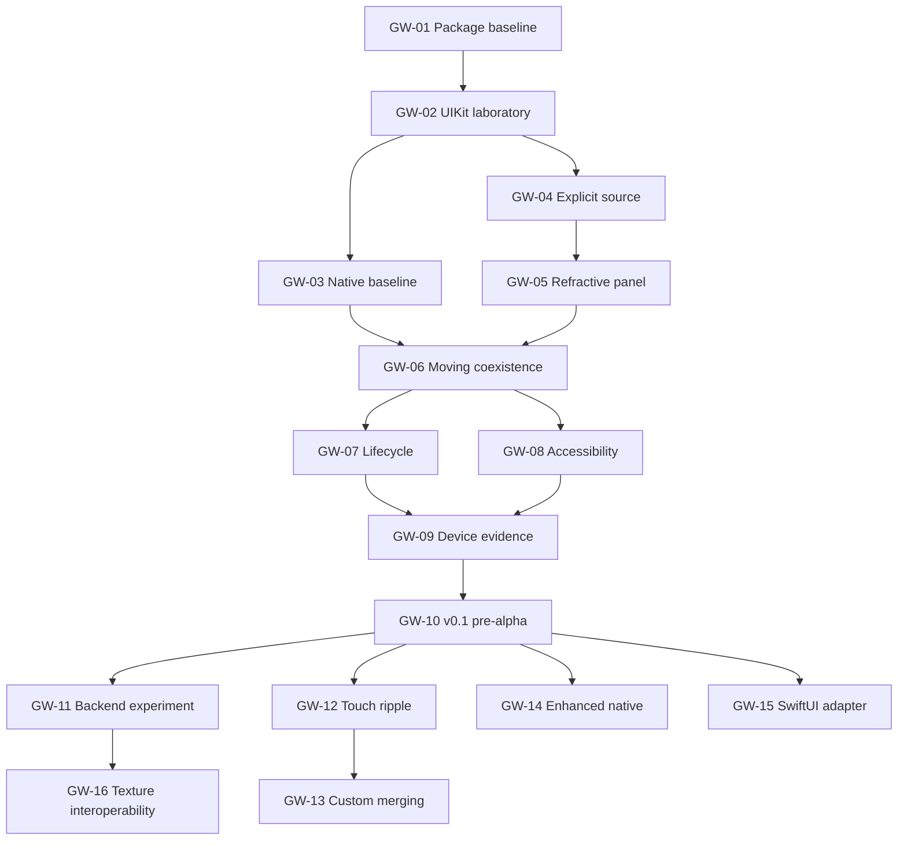

# GlassWeave implementation plan

Status: planning only; implementation will be handed to Claude. This document is an engineering plan, not a list of shipped features. The authoritative task checklist is [todo.md](todo.md).

## Product

GlassWeave will be an independently usable Apple-native glass framework. It will provide custom optical surfaces that sit naturally beside Apple's Liquid Glass, while leaving text, controls, layout, gestures, and accessibility in the native UI system. It will also provide native-glass choreography and optional surrounding effects.

The planned first presentation target is iOS/iPadOS 26. A future macOS 26 package declaration will enable core compilation and future development; it will not promise a macOS presentation adapter. Swift 6 language mode is the planned baseline. Deployment targets are a product choice, separate from GPU feature availability.

## Current preparation

- A documented architecture, task order, validation recipe, and contributor workflow.
- An independent repository, intended to become a Swift package without a Frostfield dependency.
- No package manifest, source code, renderer, tests, or CI implementation yet.
- No release tag, performance claim, or production-readiness claim.

The proposed module names in the architecture document are planning boundaries. Create a target only when a working slice needs it.

## First milestone: prove coexistence

Build a small UIKit laboratory app with a genuine native glass control next to one custom rounded refractive panel. Both sit over a deterministic moving background owned by the app. The panel contains native text and an actionable native button. Layout, rotation, touch handling, and accessibility continue to work. A physical-device report establishes the rendering cost and sustained behavior.

This milestone is complete only when tasks GW-01 through GW-09 and their checkpoint pass. A static screenshot or simulator build alone does not satisfy it.

The proposed v0.1 adds the release documentation and clean-consumer verification in GW-10. Its scope is one custom rounded panel, an explicit app-owned background, a thin native-glass mode, and a UIKit host. Touch ripples, custom/custom merging, enhanced-native effects, SwiftUI presentation, external producer integration, and a general material graph are outside v0.1.

## Architecture decisions

| Decision | Reason |
| --- | --- |
| Three explicit modes: native, enhanced-native, custom | Callers can understand which system owns the material and backdrop. |
| UIKit host backed by `MTKView` first | Tests native integration with a small presentation layer. SwiftUI will wrap the same implementation later. |
| App-owned background source for custom glass | The renderer can only refract content it receives; arbitrary application backdrops are outside this contract. |
| Conventional Metal command submission for the first proof | Establish a small correctness baseline, then compare a Metal 4 implementation under the same workload. |
| Runtime GPU capability checks, separate from OS checks | OS deployment support alone does not establish a device's Metal feature support. |
| Native content above the optical surface | Buttons and text keep native semantics, focus, layout, and accessibility. |
| Bounded resources and explicit frame ownership | A submitted texture must remain valid until GPU consumption completes. |
| No cross-repository dependency initially | A glass component must remain usable without Frostfield's scene system. |

See [architecture](../docs/architecture.md) for frame contracts and links to Apple documentation.

## Ordered delivery

| Stage | Tasks | Result |
| --- | --- | --- |
| Package and laboratory | GW-01–GW-03 | Buildable package, runnable UIKit harness, native-glass baseline. |
| Custom proof | GW-04–GW-06 | Explicit source, refractive panel, moving content, working native control. |
| Milestone 1 qualification | GW-07–GW-09 | Lifecycle, accessibility, and physical-device evidence. |
| v0.1 pre-alpha | GW-10 | A limited UIKit package with a documented source and support contract. |
| Controlled effects | GW-11–GW-14 | Backend decision, touch ripple, custom merging, enhanced-native composition. |
| Further adoption | GW-15–GW-16 | SwiftUI wrapper and optional texture interoperability. |

GW-11 is an experiment with a recorded decision, not a commitment to ship two backends. A small capability survey belongs in GW-01, but a second submission backend need not block v0.1. Do not delay the coexistence proof to build an abstract render graph or material graph.

## Dependency map

## Relationship to Frostfield

[Frostfield](https://github.com/Mitternacht/Frostfield) owns scenes, geometry, materials, lights, particles, and general graphics. GlassWeave owns optical UI surfaces, background inputs, shape behavior, and native integration.

Develop GlassWeave's first milestone first. Frostfield can independently explore a scene backend while its API remains separate. Initially exchange textures through documented Metal contracts, not scene objects. Only extract common resource or pipeline infrastructure after both repositories have measured duplicate needs. A possible future `FrostfieldMetal` product must have no dependency on scenes, mesh loaders, materials, or UI. It is not part of the initial package graph.

## Work split for coding agents

One agent owns a task and its acceptance evidence at a time. Define the source-frame contract before parallel work on optics and presentation. After GW-06, lifecycle work and accessibility work can proceed independently in separate files. After GW-10, the backend experiment, enhanced-native experiment, and SwiftUI adapter can proceed independently. Coordinate any edits to the package manifest and renderer.

For each slice: read the relevant Apple skill, consult current Apple documentation through Xcode, implement, build, exercise the result, and record the verification performed. Use Swift Testing for meaningful logic tests; use UI automation or a recorded device check for UIKit interactions. Do not add tests that only prove a scaffold exists.

## Risks and responses

| Risk | Impact | Response |
| --- | --- | --- |
| Native glass and Metal content composite differently on device | First milestone fails visually | Test coexistence before building an effects library; retain a native-only path. |
| Background source is stale or reused while in flight | Tearing, flicker, undefined GPU behavior | Explicit frame lease, synchronization, bounded in-flight work, and producer stress tests. |
| Screen and texture coordinates diverge | Refraction samples the wrong content after layout | A documented transform with rotation, scale, cropping, and resize tests. |
| Large intermediate textures dominate cost | Energy and memory regressions | Track allocated bytes; render the smallest valid region and measure native-resolution cost first. |
| UIKit updates become coupled to GPU frames | Main-thread stalls and lost interactions | Keep UI state submission separate from rendering and simulation. |
| Attractive glass harms readability or motion comfort | Inaccessible controls | Native semantics, legibility review, Reduce Motion and Reduce Transparency behavior. |
| Premature shared infrastructure couples releases | Glass adoption depends on a scene engine | Independent packages; defer extraction until two real consumers exist. |
| Custom/native merging is mistaken for a promised feature | An impossible integration expectation | Only promise custom merging when GlassWeave owns every participating optical surface. |

## Decisions to make from evidence

These do not block repository preparation:

1. Select and record a physical baseline device from the iOS 26 support range before GW-09; use the oldest available representative device and a modern higher-refresh device.
2. Decide whether Metal 4's measured benefit justifies adopting it, preserving a conventional path, or raising the supported GPU floor.
3. Decide which optical parameters belong in a public API after the first control remains usable in a real app.
4. Revisit macOS/visionOS adapters only after the iOS integration is demonstrated; no schedule is promised for them.

## Completion bar

The first milestone requires the [validation protocol](../docs/validation.md), not a claim that every proposed budget has already been achieved. Later pre-alpha release work also requires a minimal consumer app, documented failure behavior, recorded API changes, and an explicit support matrix. Any failed quality target remains visible in the report and blocks an unqualified success claim.
